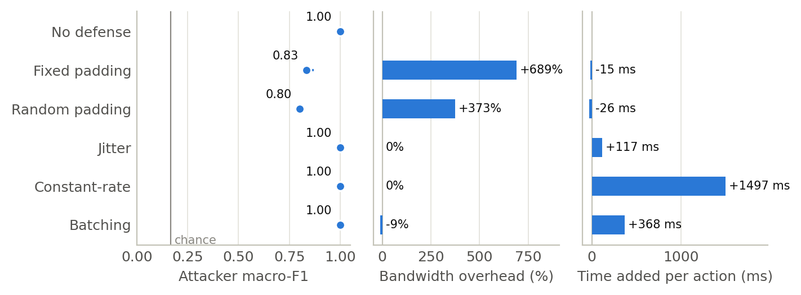
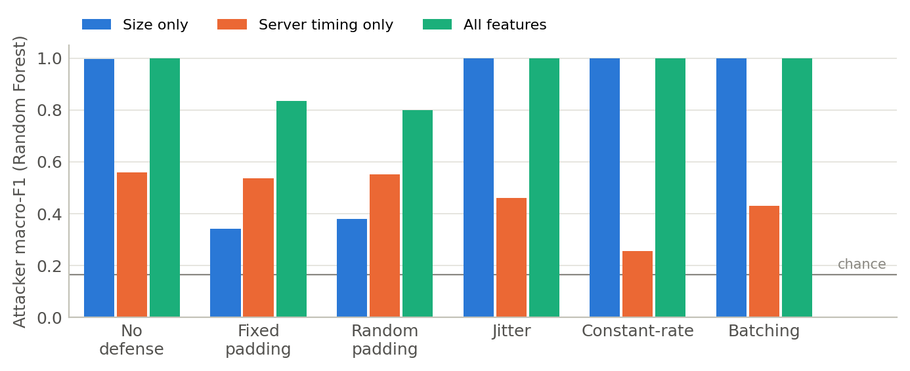
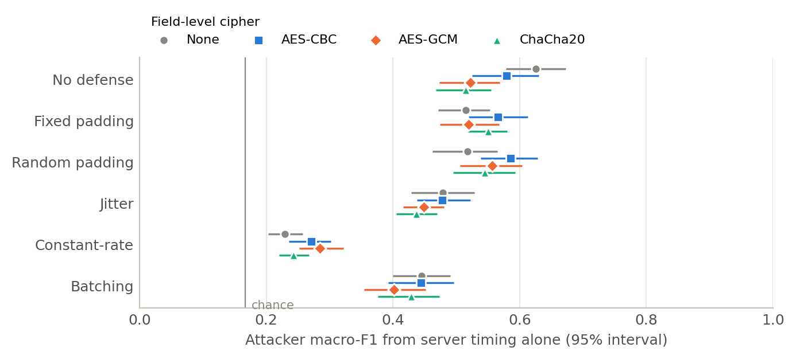

# GreenBuck

**Encrypted But Not Private: Evaluating Traffic-Analysis Defenses Against Side-Channel Attacks Across Encryption Schemes**

A security-research project investigating whether TLS encryption alone conceals user behavior. Even when traffic is encrypted, a passive network observer can still see the size and timing of each request. This project measures whether that leftover metadata is enough to classify user actions in an encrypted mobile finance app — without decrypting anything — and evaluates how well common traffic-analysis defenses reduce that leakage and at what cost.

**Status:** Data collected and analyzed (October 2026). Results are summarized below.

---

## Overview

- **Client:** Flutter (Dart) mobile app — six screens, real authentication, all traffic over TLS.
- **Backend:** FastAPI (Python) — six endpoints, Argon2id password hashing, JWT auth, role-based access (admin/user). Two middleware layers instrument every request: one logs timing metadata, one applies configurable traffic-shaping defenses.
- **Database:** PostgreSQL (users, transactions, timing_log).
- **Capture rig:** Runs on a dedicated Linux host (a Raspberry Pi 5 during development, a Linux laptop for the study's captures). A Python orchestrator resets the database, starts tcpdump, runs a shuffled schedule of user actions through a Flutter integration test, stops the capture, and pulls the pcap back.
- **Analysis:** Python pipeline in `analysis/` — parses the pcaps, labels every request, trains Random Forest and k-NN classifiers, measures each defense's overhead and draws the figures.

The backend, database, and capture point run on the same host to keep the single measured network hop clean. This is a controlled research testbed, not a production finance app.

---

## Repository Structure

```
Greenbuck/
├── lib/                    Flutter client source (screens, services, models)
├── integration_test/       Integration test that drives the captured actions
├── pubspec.yaml            Flutter dependencies
├── api/                    FastAPI backend
│   ├── main.py
│   ├── requirements.txt
│   ├── schema.sql
│   └── run.sh.example
├── capture/                Capture orchestration
│   ├── run_capture.py      Runs one capture end to end
│   ├── reset_state.sql     Database seed applied before every run
│   └── data/               Captured pcaps + markers.jsonl (gitignored)
├── analysis/               Analysis pipeline and results
│   ├── check_captures.py   Validates a capture set before analysis
│   ├── extract_exchanges.py  pcaps → one labeled row per request (exchanges.csv)
│   ├── build_research_db.py  Builds the research database (SQLite + Postgres load script)
│   ├── analyze.py          Classification and overhead → results/*.csv
│   ├── make_figures.py     Paper figures and LaTeX tables
│   ├── deck_figures.py     Slide versions of the figures (dark theme)
│   ├── failure_checks.sql  Checks that the one failed run left no trace in the data
│   ├── requirements.txt    Exact library versions used for the results
│   ├── results/            classification.csv, confusion.csv, overhead.csv
│   └── figures/            Figures (PNG + PDF) and LaTeX tables
├── .env.example            Template for environment variables
└── README.md
```

---

## Setting Up Your Own Instance

You do **not** need a dedicated capture host to develop the app and backend. You
run your own local copy of the backend and database for development. A dedicated
Linux host (a Raspberry Pi or a laptop) is only needed to reproduce the actual
capture and data-collection setup.

### Prerequisites
- Python 3.11+ for the backend; Python 3.10+ for the analysis
- PostgreSQL
- Flutter SDK (with Android Studio + an emulator, or a physical Android device)
- Git

### Backend Setup

1. **Clone the repo and enter the backend folder:**
   ```
   git clone https://github.com/SpeerGabe/Greenbuck.git
   cd Greenbuck/api
   ```

2. **Create and activate a virtual environment:**
   ```
   python -m venv venv
   source venv/bin/activate        # macOS/Linux
   venv\Scripts\activate           # Windows
   ```

3. **Install dependencies:**
   ```
   pip install -r requirements.txt
   ```

4. **Create the database and the database user, then load the schema.**
   In `psql` (as a superuser):
   ```sql
   CREATE DATABASE greenbuck;
   CREATE USER greenbuck_user WITH PASSWORD 'choose-a-password';
   ```
   Then load the schema:
   ```
   psql greenbuck < schema.sql
   ```
   (The schema grants table access to `greenbuck_user`, so that user must exist first.)

5. **Provide the backend's secrets.** The backend reads `SECRET_KEY`, `DB_USER`,
   and `DB_PASSWORD` from the environment — they are never hardcoded. There are
   two equivalent ways to set them:

   - **Using a `.env` file (recommended if you have internet):** install
     `python-dotenv` (`pip install python-dotenv`), copy `../.env.example` to a
     `.env` file, and fill in your values. The backend loads it automatically.
   - **Using a shell script (works offline, no extra package):** copy the
     included template and edit it:
     ```
     cp run.sh.example run.sh
     ```
     Set in `run.sh`:
     - `SECRET_KEY` — any long random string
       (generate one with `python -c "import secrets; print(secrets.token_hex(32))"`)
     - `DB_USER` — `greenbuck_user`
     - `DB_PASSWORD` — the password you chose above

   Both `.env` and `run.sh` hold secrets and are gitignored — never commit them.

6. **Run the backend:**
   ```
   chmod +x run.sh
   ./run.sh
   ```
   (Or, if using a `.env` file, launch uvicorn directly:
   `uvicorn main:app --host 0.0.0.0 --port 8000`.)

   For local development you can run without TLS by removing the
   `--ssl-keyfile`/`--ssl-certfile` flags (the TLS certificates are not included
   in the repo — they are specific to the research server). Without those flags the
   server runs on plain HTTP, which is fine for app development.

### Frontend Setup

Run these from the repository root (the Flutter app is at the root, not in a
subfolder).

1. **Get dependencies:**
   ```
   cd Greenbuck
   flutter pub get
   ```

2. **Run the app, pointed at your backend.** The backend address is set at build
   time with `--dart-define=BASE_URL=...` (default `https://192.168.1.100:8000`):
   ```
   flutter run --dart-define=BASE_URL=http://10.0.2.2:8000
   ```
   - Android emulator reaching your computer's localhost: `http://10.0.2.2:8000`
   - Physical device on the same network: `http://<your-computer-LAN-IP>:8000`
   - (If your backend runs without TLS for local dev, use `http://`, not `https://`.)

### Creating a User

The database starts empty. Open the app, tap **Create Account** to register, then
log in with those credentials. Admin accounts are assigned manually in the database:
```sql
UPDATE users SET role = 'admin' WHERE username = 'your-username';
```

### Running Captures (Data Collection)

Captures run from your dev machine and require a reachable capture host running
the backend. The orchestrator starts tcpdump on that host, triggers the user
actions through the Flutter integration test, stops the capture, and pulls the
resulting `.pcap` back to your machine.

1. **Set the capture host's connection details.** Copy `.env.example` to `.env`
   at the repo root and fill in the host's details (the variables keep their
   original `PI_` names, whatever the host is):
   ```
   PI_HOST=your-device-ip
   PI_USER=your-device-username
   PI_PASS=your-device-password
   PI_INTERFACE=eth0
   ```
   (`run_capture.py` loads these via `python-dotenv`; the real `.env` is gitignored.)

2. **Run a capture.** With the backend running on the capture host and an Android
   emulator (or device) active:
   ```
   python capture/run_capture.py --platform android --encryption none --mitigation none --run 1
   ```
   One run is one capture: the database is reset, tcpdump starts, and the
   integration test runs a shuffled schedule of actions in a single app session
   (10 of each action by default). Options:
   - `--per-action N` — iterations of each action
   - `--mix make_transfer=20,logout=20,register=20,login=5` — iterations per
     action; unlisted actions get 0. `make_transfer` is capped at 25 per run.
   - `--seed N` — seed for the schedule shuffle (default random; written to the marker)
   - `--think-ms N` — pause after each step (default 2000)

   The study's dataset used `--per-action 1` (one of each action per run) with
   the default 2000 ms think time.

   Set `FLUTTER_DEVICE` in `.env` (an id from `flutter devices`) if more than one
   device is attached.

Captured `.pcap` files, the per-run `markers.jsonl` log and the per-action
`iterations.jsonl` log are written to `capture/data/`, which is gitignored — raw
capture data is not committed.

### Running the Analysis

The analysis reads a capture data folder (the pcaps plus `markers.jsonl`,
`iterations.jsonl` and `batch_log.txt`). From `analysis/`:

```
pip install -r requirements.txt
python check_captures.py ../capture/data
python extract_exchanges.py ../capture/data work
python analyze.py work/exchanges.csv ../capture/data/iterations.jsonl results
python make_figures.py results figures
```

1. `check_captures.py` lists clean runs per configuration and flags any run whose
   test failed, whose pcap is missing or empty, or that reported fewer actions
   than scheduled.
2. `extract_exchanges.py` reassembles each TCP connection, parses the TLS records,
   and writes one row per request with its size and timing features. Labels come
   from each run's schedule: every action sends a fixed sequence of requests, so
   the run's requests are matched to that sequence in order.
3. `analyze.py` scores Random Forest and k-NN for every cipher × defense, with
   5-fold cross-validation grouped by run and 95% intervals from resampling whole
   runs. It also measures each defense's bandwidth and time cost. A full run takes
   tens of minutes.
4. `make_figures.py` draws the figures and LaTeX tables in `figures/`.

To keep the data in PostgreSQL as well, run
`python build_research_db.py ../capture/data work/exchanges.csv db`, then
`psql -d <your database> -v ON_ERROR_STOP=1 -f postgres_load.sql` from inside `db/`.

The scores depend on the scikit-learn version: the results below used
scikit-learn 1.7.2, and scikit-learn 1.9.1 scores the padding defenses 0.02–0.03
higher (same data, same folds, same ranking). `requirements.txt` pins the
versions used.

---

## Research Design

- **Actions (6):** login, logout, register, view history, make transfer, check balance
- **Mitigations:** none (control) plus two size and three timing defenses:
  - *padding* (size, fixed): every request and response body is 4096 B on the
    wire, with plaintext first padded to 2048 B inside the encryption; small
    headers even out the request line, Authorization header and status line
  - *random padding* (size, random): every request and response body gets a
    random 1–4096 B of filler and a random 1–256 B header, drawn per message
  - *jitter* (timing, random): random 0–50 ms delay before each response, on
    the server only
  - *constant-rate* (timing, fixed): every response held to a fixed total time
    (`CONSTANT_RATE_TARGET_MS`), on the server only
  - *batching* (timing): the client queues requests for 300 ms and sends them
    as one `/batch` request

  Both padding defenses send a body on every request, GETs included.
- **Encryption:** four field-level cipher settings — none, AES-256-CBC,
  AES-256-GCM and ChaCha20-Poly1305 — on client and server, keyed per session by
  an X25519 exchange at login. AES-256-CBC is unauthenticated and serves as the
  weak baseline. Underneath, every connection used TLS 1.3 with AES-256-GCM.
- **Dataset:** 24 configurations (4 cipher settings × 6 defense settings), 30
  runs each on a closed network with no internet. 719 of 720 runs completed (one
  AES-GCM + random padding run exited with an error before saving anything),
  giving 15,817 labeled requests.
- **Analysis:** supervised classification (Random Forest, k-NN) of each request
  from its TLS record sizes, packet counts, server response time and the
  client's pause before it, scored with macro-F1 (chance is 0.17 for six actions).

---

## Results

| Defense | Attacker macro-F1 | Bandwidth cost | Time cost per action |
| --- | --- | --- | --- |
| None | 1.00 | — | — |
| Fixed padding | 0.83 | +689% | −15 ms |
| Random padding | 0.80 | +373% | −26 ms |
| Jitter | 1.00 | 0% | +117 ms |
| Constant-rate | 1.00 | 0% | +1,497 ms |
| Batching | 1.00 | −9% | +368 ms |

Random Forest on all features, averaged over the four cipher settings. Bandwidth
is TLS application bytes per run; time is the phone-measured duration of each
action, relative to no defense. Time differences within ±30 ms are within
run-to-run variation.



- **Only padding lowered the attacker's score.** The timing defenses cost time
  but protected nothing, because every request type still had its own size.
- **Padding falls short because timing still leaks.** With sizes hidden, login
  and register stand out: the server's Argon2id password hash takes about 50 ms,
  against 3–6 ms for everything else.



- **RQ1 — do ciphers influence the defenses?** Not meaningfully. Attacker accuracy
  didn't change with the cipher (0.81–0.87 under fixed padding across the four
  settings), and the cipher's effect on server-timing leakage was small and
  inconsistent in direction.
- **RQ2 — which defense balances protection and cost best?** Random padding: the
  attacker's score fell from 1.00 to 0.80 at +373% bandwidth and no time cost.



The raw captures (719 pcaps) and the research database are not in the repository.

---

## Team

- **Gabriel Speer** — security architecture, threat model, Flutter client, FastAPI backend and database, capture pipeline, data analysis
- **Jose Hipolito** — field-level encryption (AES-256-CBC, AES-GCM, ChaCha20-Poly1305) on client and server, X25519 key exchange, encryption middleware, mitigations, security hardening

---
